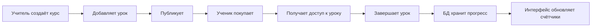

# Что изменилось и как это устроено

Разбор для автора проекта, 26 ноября 2026 года. Здесь объясняются исправления, выполненные в последнем этапе, и то, как они продолжают предыдущие ручные исправления. Практические задания вынесены в [PRACTICE.md](PRACTICE.md).

## 1. Главная цель: соединить пользовательский сценарий

В проекте уже были нужные технологии, но часть компонентов работала с подставными данными, часть обращалась к отсутствующим API, а несколько реализаций одного действия расходились между собой. Добавление ещё одной библиотеки этого не исправляло.

Теперь путь данных выглядит так:



Для каждого перехода нужны согласованные маршрут, DTO, проверка прав, изменение в БД и обновление интерфейса. Поэтому исправления затронули несколько слоёв. Успешная компиляция отдельного компонента ещё не доказывает работоспособность всей цепочки.

В авторском интерфейсе появились список собственных курсов и редактор. Он позволяет добавить текст урока и прямую видеоссылку, увидеть список уроков, опубликовать курс и открыть предпросмотр. Это минимальный рабочий редактор: изменение уже добавленного текста, удаление и перестановка уроков пока не реализованы.

## 2. Аутентификация, роль и владелец — три разных вопроса

Аутентификация отвечает: «Кто отправил запрос?» Фильтр проверяет JWT и помещает в Spring Security объект `JwtPrincipal` с UUID, email и ролью. Контроллер получает его через `@AuthenticationPrincipal`. Не нужно создавать случайный UUID автора, разбирать строку record или ожидать вместо principal сущность JPA.

Авторизация отвечает: «Что этому человеку разрешено?» Проверка роли TEACHER/ADMIN позволяет вызвать создание курса. Проверка `course.authorId == principal.id` отдельно определяет, может ли этот человек изменять конкретный существующий курс. Наличие роли учителя не означает право редактировать материалы другого учителя.

Третий вопрос обучения: «Есть ли доступ именно к этому курсу?» Для уроков проверяются существование курса, его видимость и активная запись ученика либо авторство. При запросе конкретного урока дополнительно проверяется пара `courseId + lessonId`.

В текущей реализации:

| Ситуация | Ответ |
| --- | --- |
| Нет действующей авторизации для личных данных | 401 |
| Авторизация есть, роль или доступ не подходят | 403 |
| Курс/урок отсутствует либо черновик скрыт от пользователя | 404 |
| Повторная покупка, нехватка средств, недоступный к покупке курс | 409 |

403 не означает, что JWT испортился. Поэтому frontend сохраняет сессию при запрете отдельного действия. На 401 токен удаляется и открывается вход. При временной недоступности сервера восстановление сессии показывает повторную попытку вместо удаления действующего токена.

## 3. Зачем `JwtPrincipal` и исключения находятся в корне `common`

В стандартной модели Spring Modulith корневой пакет модуля является его API, а вложенные пакеты — деталями реализации. Java-модификатор `public` сам по себе не делает внутренний пакет публичным API модуля. Альтернатива корневому пакету — явно объявленные именованные интерфейсы. См. [модель модулей Spring Modulith 2.1](https://docs.spring.io/spring-modulith/reference/2.1/fundamentals.html).

Поэтому общие `ConflictException`, `NotFoundException`, `JwtPrincipal` и `TokenIssuer` находятся в `com.example.lms.common`. Другим модулям можно зависеть от этих контрактов. `common.exception.GlobalExceptionHandler` остаётся внутренней инфраструктурой: бизнес-модули его не вызывают.

Это отвечает и на прежний вопрос о `ConflictException`: папка `common/exception` возможна, если она объявлена публичным интерфейсом. Для текущего небольшого набора типов проще корень `common`. Перенос в подпапку только ради красоты без изменения модульной конфигурации снова нарушит проверку границ.

`TokenIssuer` скрывает реализацию подписи токена: `AuthService` просит выдать токен через интерфейс, а `JwtUtils` реализует этот интерфейс. Пользователи больше не импортируют внутреннюю реализацию безопасности.

Для обучения модуль `enrollments` использует публичный `courses.CourseLessonLookup`. Тот возвращает простые данные курса и урока, а не `CourseEntity`. Так изменения внутренней JPA-модели меньше затрагивают соседей. Архитектурный тест проверяет эти зависимости. Генерируемые классы jOOQ исключены как общая инфраструктура; SQL-границы владения таблицами этот тест не доказывает.

## 4. Транзакция покупки: все изменения вместе

Покупка меняет три вещи: баланс кошелька, запись в журнале и доступ к курсу. Если сохранить только первые две, деньги спишутся без доступа. Если сохранить только доступ, платный курс станет бесплатным.

`PurchaseService.purchaseCourseAtomic` выполняет их в одной транзакции:

```text
проверить курс и его статус
получить кошелёк с FOR UPDATE
проверить повторную покупку и остаток средств
уменьшить баланс
добавить положительную WITHDRAWAL для платного курса
создать ACTIVE enrollment
COMMIT
```

Если вставка enrollment не удалась, должны откатиться и уже выполненные SQL списания/журнала. Это проверяется тестом с намеренно установленным ограничением, запрещающим вставку доступа. После ошибки баланс, число списаний и число покупок остаются прежними.

`@Transactional` работает на границе вызова Spring-компонента. По стандартным правилам необработанный `RuntimeException` приводит к откату; для checked exceptions правила могут потребовать отдельной настройки. Если перехватить ошибку внутри метода и вернуть обычный результат, можно скрыть от инфраструктуры причину отката. См. [правила rollback Spring](https://docs.spring.io/spring-framework/reference/data-access/transaction/declarative/rolling-back.html).

Транзакция не является автоматической защитой от всех параллельных запросов. Для этого нужен следующий механизм.

## 5. Зачем нужна блокировка, если транзакция уже есть

Представь баланс 300 и два одновременных запроса на один курс за 100. Оба могут прочитать старое состояние до изменений другого запроса. Поэтому проверка «ещё не куплен» должна выполняться после получения блокировки одного и того же кошелька.

`SELECT ... FOR UPDATE` не позволяет другой транзакции одновременно получить конфликтующую блокировку этой строки или изменить её. Она ждёт завершения первой. Обычный `SELECT` при этом не обязан ждать: PostgreSQL использует MVCC. Блокировка держится до завершения транзакции. См. [блокировки строк PostgreSQL 16](https://www.postgresql.org/docs/16/explicit-locking.html).

В нашем сценарии первый запрос покупает курс и фиксирует изменения. Второй получает кошелёк после ожидания, заново проверяет enrollment и отвечает 409. В итоге одна покупка, одно списание и баланс 200. Для разных покупок одного ученика тот же механизм защищает общий остаток кошелька.

Дополнительные случаи:

- При добавлении урока блокируется строка курса. Порядок вычисляется как `max(ordinal_number) + 1`, поэтому два одновременных добавления не получают одинаковый номер.
- При завершении урока блокируется enrollment. Два запроса завершают проверку и сохранение последовательно; второй видит существующий прогресс и возвращает 200.

Блокировки должны быть короткими. Внутри них нельзя ждать пользователя или ответ внешнего платёжного сервиса. Если позднее появятся операции с несколькими кошельками, нужно заранее определить единый порядок захвата строк.

## 6. `UNIQUE`, `CHECK`, внешний ключ и `@Valid`

Это разные уровни защиты:

| Уровень | Пример в LMS | Зачем |
| --- | --- | --- |
| Проверка формы | Пользователь видит неверную цену до отправки | Удобство |
| HTTP-валидация DTO | Цена неотрицательная, `courseId` обязателен | Понятный ответ 400 |
| Бизнес-проверка | Курс опубликован, пользователь не автор, денег хватает | Правила сценария |
| Блокировка | Другой запрос не меняет проверяемый кошелёк параллельно | Согласованность при конкуренции |
| Ограничения БД | Уникальная покупка, баланс >= 0, существующий урок | Целостность данных |

`@Valid` просит проверить ограничения полей DTO. Само по себе оно не означает «не null», «правильный email» или «курс существует». Правила задают `@NotNull`, `@NotBlank`, `@Email`, `@DecimalMin`, `@Digits` и другие аннотации. Вложенный DTO также требует каскадной проверки через `@Valid`.

В контроллере стоит `@Valid @RequestBody CreateCourseRequest request`. Сначала JSON преобразуется в DTO, затем проверяются ограничения, затем при успехе вызывается метод. Сломанный JSON или неразбираемый UUID отсекается при преобразовании, ещё до проверки правил DTO. Для DTO и прямых ограничений параметров MVC может выбрасывать разные исключения; обработчик LMS учитывает оба варианта. См. [валидацию Spring MVC](https://docs.spring.io/spring-framework/reference/web/webmvc/mvc-controller/ann-validation.html).

Например, у нашей цены есть `@DecimalMin("0.00")` и `@Digits(integer = 8, fraction = 2)`. `-1` и `1.123` не доходят до создания курса; ответ содержит `fields.price`. Для `courseId` отсутствие значения отсекает `@NotNull`. Ни одна из этих аннотаций не заменяет проверку покупки в сервисе.

V8 добавляет `CHECK` для денег и положительного порядка уроков, `UNIQUE(course_id, ordinal_number)` и внешний ключ от прогресса к уроку. Это защищает от некорректных записей через SQL, будущий сервис или ошибку в коде. Внешний ключ подтверждает существование урока, но не его принадлежность курсу enrollment — это правило остаётся в сервисе.

Не нужно превращать любое нарушение ограничения SQL в 409. Оно может означать ошибку сервера. Для ожидаемого конфликта нужно знать конкретное нарушенное правило. Задание с email как раз учит этому различию.

## 7. Почему `save`, `flush` и `commit` не одно и то же

В JPA добавление объекта в управляемую коллекцию ещё не означает немедленную вставку SQL. В уроках используется каскад от курса. Чтобы вернуть ID фактически сохранённого нового урока, сервис вызывает `flush()` после добавления.

`flush` отправляет ожидающие изменения в БД и позволяет обнаружить ошибки ограничений, но транзакция ещё может откатиться. `commit` завершает транзакцию. Поэтому не нужно объяснять `flush` как «окончательно сохранил».

Это особенно важно при сочетании JPA и jOOQ: у JPA есть контекст управляемых объектов, у jOOQ — SQL-запросы. Нельзя бездумно считать, что изменение Java-объекта уже видно любому следующему SQL. В покупке все три записи выполняются jOOQ внутри одной проверенной транзакции; JPA сохраняется для агрегатов курса и прогресса.

Для денег используется `BigDecimal`, потому что здесь нужны точные десятичные значения и согласованная с `numeric` шкала. Проверка достаточности использует `compareTo`, а не сравнение объектов по ссылке. Учебный внутренний баланс сам по себе не превращает приложение в готовую платёжную систему.

## 8. Почему сохранены события, но удалена вторая покупка

Раньше существовали два пути выдачи доступа и списания. Их поведение расходилось. Теперь покупку выполняет один атомарный сервис. События оставлены там, где они связывают вторичные данные: после создания пользователя появляется кошелёк, после публикации курса обновляется billing product.

`@ApplicationModuleListener` сочетает асинхронную обработку после успешной транзакции и отдельную транзакцию обработчика. Между ответом регистрации и готовностью кошелька возможна небольшая задержка. Реестр публикаций Modulith помогает учитывать доставку и завершение обработчиков; восстановление незавершённых публикаций требует операционной настройки. См. [события Spring Modulith](https://docs.spring.io/spring-modulith/reference/events.html).

Обработчик кошелька теперь использует `ON CONFLICT(user_id) DO NOTHING`: повтор события не создаёт второй кошелёк и не обнуляет существующий баланс. Проекция курса обновляет цену по конфликту course ID. Это примеры идемпотентности: повтор применения того же факта не портит результат.

Локальный инициализатор повторно публикует события для известных демоаккаунтов, чтобы восстановить отсутствующие кошельки. Он не меняет существующие пароли или остатки. При удалении или переносе инициализатора нужно сохранить это свойство.

Проекция `billing_products` сейчас не используется как источник цены при покупке: покупка читает курс. Это осознанное оставшееся упрощение. Для строгих границ модулей нужно выбрать владельца цены и процесса, а не объявлять текущий SQL полностью независимым модульным API.

## 9. Серверное состояние и состояние интерфейса

Баланс, покупки и прогресс принадлежат серверу. Не нужно хранить независимую копию «кошелька 5000» в Zustand и списывать из неё после клика. Иначе отказ API, другой браузер или повтор запроса рассинхронизируют интерфейс и БД.

Теперь Zustand содержит данные сессии, а TanStack Query — загруженные серверные данные. После покупки инвалидируются кошелёк и мои курсы. После завершения урока — сам урок, программа и список моих курсов. Инвалидация помечает данные устаревшими; активные запросы обновляются. См. [Query invalidation](https://tanstack.com/query/v5/docs/framework/react/guides/query-invalidation).

У приватных запросов ключ включает ID пользователя, например `['courses', 'my', userId]`. Поэтому данные ученика A не считаются данными ученика B. При выходе и новом входе кэш очищается, а запросы получают `AbortSignal`, чтобы прекращать ненужную загрузку. В браузере это проверено переходом от ученика с купленным курсом к новому аккаунту без покупок.

Инвалидация после завершения покупки выполняется и при ошибке: ответ мог потеряться после успешного commit. Повторное чтение показывает реальное состояние. Серверная защита от повторной покупки остаётся необходимой даже при заблокированной на время запроса кнопке.

## 10. Почему активный урок находится в URL

Маршрут `/courses/:courseId/lessons/:lessonId` содержит весь выбор пользователя. Ссылку можно открыть напрямую и обновить страницу. Состояние активного урока больше не переносится случайно из одного курса в другой через глобальный store.

Маршрут `/player` сначала получает программу и перенаправляет на первый урок. Программа теперь плоская, как реальная модель уроков в БД; выдуманных модулей над ней нет. Завершённость и счётчики приходят из API.

URL управляет навигацией, а сервер управляет доступом. Подмена UUID в адресной строке не даёт права читать другой урок. Этот сценарий проверяется интеграционно и в браузере.

## 11. Что исправлено в сборке

Порядок backend теперь: `initialize` с Flyway → `generate-sources` с jOOQ → компиляция → тесты → сборка jar. Генератор видит уже актуальную схему. Для сборки всё ещё нужна доступная PostgreSQL — генерация пока основана на живой БД.

Maven-профиль и Spring-профиль действуют в разных системах. `-Ptest-db` настраивает Maven-плагины. `@ActiveProfiles("test")` настраивает Spring внутри тестов. При ручном запуске сервера `src/test/resources` обычно не входит в runtime. Именно смешение этих механизмов привело к ошибке первого QA-запуска. Для отдельного сервера адрес БД теперь задаётся явно и проверяется до сценариев.

В POM тестовый профиль стоит после профиля окружения и имеет приоритет при совместной активации. Это отдельно проверено вычислением `db.url` с заведомо другим `DB_URL`: результат остался `localhost:55432/lms_test`. Правила слияния профилей описаны в [документации Maven](https://maven.apache.org/guides/introduction/introduction-to-profiles.html). Не переопределять `-Ddb.url` основной БД при запуске тестов.

Применённые V1–V7 не переписаны. Для новых ограничений добавлена V8. Flyway сравнивает миграции с историей, включая контрольные суммы, поэтому редактировать уже применённый SQL ради удаления комментария нельзя. См. [Flyway Validate](https://documentation.red-gate.com/flyway/reference/commands/validate).

Во frontend исправлена фактическая точка входа `index.html`, удалена дублирующая инициализация, подключены Tailwind и PostCSS. Страницы загружаются через `React.lazy` и динамический `import()`, `Suspense` показывает ожидание. См. [React lazy](https://react.dev/reference/react/lazy). В проверенной сборке основной файл уменьшился с прежних примерно 515 kB до 311 kB без gzip. Остальной код не исчез: он вынесен в отдельные файлы и загружается по необходимости.

## 12. Что доказывают проверки и с чего учиться дальше

21 тест — это 18 тестов рабочих сценариев, два архитектурных/документирующих и один запуска контекста. Проверки денег выполняются в реальной отдельной PostgreSQL, поскольку блокировки и ограничения важны именно в ней. Тест rollback намеренно проверяет состояние после ошибки, а не только наличие HTTP 500.

Браузерная проверка дополнительно подтверждает, что кнопки, маршруты, стили, баланс и прогресс работают вместе. Она не заменяет нагрузочные проверки, аудит зависимостей, тесты всех размеров экрана и подготовку внешнего окружения.

Рекомендуемый порядок чтения кода: `PurchaseService` → `LmsWorkflowIntegrationTest` → `LearningQueryService` → `CourseLessonLookup` → хуки покупки и завершения → `AuthProvider`. После этого выполнить первое задание из [PRACTICE.md](PRACTICE.md), а не начинать новый большой рефакторинг.
